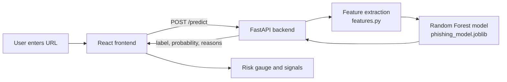

# PhishGuard — Phishing URL Detector

A full-stack machine learning app that checks whether a URL looks like **phishing** or **legitimate**. Paste a link, get a phishing probability, a clear verdict, and a list of the suspicious patterns that were found.

The URL is analyzed **as text only**. The website is never visited or opened.

| Layer    | Technology                                             |
| -------- | ------------------------------------------------------ |
| Frontend | React 19, TypeScript, Vite, Tailwind CSS 4             |
| Backend  | Python, FastAPI, Uvicorn                               |
| ML       | scikit-learn (Random Forest), pandas, joblib, tldextract |

---

## Table of Contents

1. [Features](#features)
2. [How it works](#how-it-works)
3. [Project structure](#project-structure)
4. [Prerequisites](#prerequisites)
5. [Setup and run locally](#setup-and-run-locally)
6. [Training the model](#training-the-model)
7. [API reference](#api-reference)
8. [Model details](#model-details)
9. [Configuration](#configuration)
10. [Troubleshooting](#troubleshooting)
11. [Limitations](#limitations)
12. [Roadmap](#roadmap)

---

## Features

- Instant phishing probability (0–100%) with a coloured risk gauge
- Three verdict levels: **Likely Safe**, **Suspicious**, **Likely Phishing**
- Human-readable explanation of the detected signals (suspicious words, many subdomains, IP address, no HTTPS, etc.)
- Recent checks history and one-click example URLs
- Input validation (empty and over-long URLs are rejected)
- Model is loaded once at server start, so predictions are fast
- Interactive API docs at `/docs` (Swagger UI)
- Responsive, accessible dark UI with proper SEO / social-sharing meta tags

---

## How it works



1. The frontend sends the URL to `POST /predict`.
2. The backend turns the URL into numeric features (length, dots, hyphens, digits, subdomains, suspicious keywords, and so on).
3. The trained Random Forest returns a phishing probability and a label.
4. The backend adds a list of human-readable reasons, and the frontend displays everything.

---

## Project structure

```
phishing-detector/
├── backend/
│   ├── main.py                 # FastAPI app: /, /health, /predict
│   ├── features.py             # URL → numeric feature extraction
│   ├── requirements.txt        # Pinned Python dependencies
│   └── model/
│       └── phishing_model.joblib   # Trained model (created by ml/train.py)
├── ml/
│   ├── train.py                # Training script (run this to build the model)
│   ├── notebook.ipynb          # Exploration notebook
│   └── data/
│       └── urlset.csv          # Dataset (not committed, see below)
├── frontend/
│   ├── index.html              # HTML shell with SEO / social meta tags
│   ├── public/                 # favicon.svg, og-image, manifest, app icons
│   └── src/
│       ├── App.tsx             # Main UI
│       ├── index.css           # Tailwind + fonts + animations
│       └── services/api.ts     # API client (set API_URL here)
└── README.md
```

> `ml/data/urlset.csv` and `venv/` are listed in `.gitignore`, so they are not in the repository. You must add the dataset yourself (see [Training the model](#training-the-model)).

---

## Prerequisites

| Tool    | Version                | Check with         |
| ------- | ---------------------- | ------------------ |
| Python  | 3.11 or newer (3.12 tested) | `python --version` |
| Node.js | 20.19+ or 22.12+       | `node --version`   |
| npm     | comes with Node        | `npm --version`    |
| Git     | any recent version     | `git --version`    |

On macOS and Linux you may need to type `python3` instead of `python`.

---

## Setup and run locally

You need **two terminals**: one for the backend and one for the frontend.

### 1. Clone the repository

```bash
git clone https://github.com/Dp20703/phishing-detector.git
cd phishing-detector
```

### 2. Backend

Create a virtual environment in the project root and install the dependencies.

**Windows (PowerShell or CMD)**

```bash
python -m venv venv
venv\Scripts\activate
pip install -r backend\requirements.txt
```

**macOS / Linux**

```bash
python3 -m venv venv
source venv/bin/activate
pip install -r backend/requirements.txt
```

Make sure the model exists at `backend/model/phishing_model.joblib`. If it doesn't, build it first (see [Training the model](#training-the-model)).

Start the server **from inside the `backend` folder**:

```bash
cd backend
uvicorn main:app --reload --port 8000
```

Verify it works:

- Health check: <http://127.0.0.1:8000/health> should show `"model_loaded": true`
- Interactive docs: <http://127.0.0.1:8000/docs>

### 3. Frontend

Open a **second terminal** in the project root:

```bash
cd frontend
npm install
npm run dev
```

Open <http://localhost:5173> in your browser, paste a URL and click **Analyze URL**.

### Production build of the frontend (optional)

```bash
cd frontend
npm run build      # outputs to frontend/dist
npm run preview    # serve the built app locally
```

---

## Training the model

The saved model must be rebuilt whenever you change `backend/features.py` or `ml/train.py`.

### 1. Add the dataset

Place your labeled dataset at:

```
ml/data/urlset.csv
```

Required columns:

| Column   | Meaning                                                                 |
| -------- | ----------------------------------------------------------------------- |
| `domain` | The URL text, usually without `http(s)://` (it may include a path)      |
| `label`  | `1` = phishing, `0` = legitimate                                        |

The project was developed with a dataset of about 95,900 unique URLs (about 48,000 legitimate and 47,900 phishing). Other columns in the file are ignored.

### 2. Run training

From the project root, with the virtual environment active:

```bash
python ml/train.py
```

The script works from any directory. It will:

1. Load and clean the data (drop missing values and duplicates).
2. Split into 80% train / 20% test (stratified).
3. Build augmented training data (see [Model details](#model-details)).
4. Train **Logistic Regression** and **Random Forest**, print precision, recall, F1 and confusion matrices.
5. Pick the model with the better F1 score.
6. Save it (compressed) to `backend/model/phishing_model.joblib`.

Restart the backend after retraining so the new model is loaded.

---

## API reference

Base URL: `http://127.0.0.1:8000`

### `GET /`

Basic status message.

```json
{ "message": "Phishing URL Detector API", "status": "running" }
```

### `GET /health`

Confirms the server is up and the model is loaded.

```json
{ "status": "healthy", "model_loaded": true }
```

### `POST /predict`

**Request**

```json
{ "url": "https://github.com" }
```

Rules: the URL must not be empty and must be at most 2048 characters.

**Response**

```json
{
  "url": "https://github.com",
  "label": "legitimate",
  "probability": 0.3357,
  "reasons": ["No obvious suspicious URL signals detected"]
}
```

| Field         | Type                          | Description                                  |
| ------------- | ----------------------------- | -------------------------------------------- |
| `url`         | string                        | The URL that was analyzed                    |
| `label`       | `"phishing"` or `"legitimate"` | Model verdict                                |
| `probability` | number (0–1)                  | Probability that the URL is phishing         |
| `reasons`     | string[]                      | Up to 5 human-readable signals               |

**Example with curl**

```bash
curl -X POST http://127.0.0.1:8000/predict \
  -H "Content-Type: application/json" \
  -d '{"url": "http://secure-login.paypal.verify-account.example.tk/update"}'
```

**Errors**

| Status | Meaning                                        |
| ------ | ---------------------------------------------- |
| 400    | The URL could not be analyzed                  |
| 422    | Validation failed (empty or too long URL)      |
| 503    | The model is not loaded                        |

---

## Model details

### Features

`features.py` extracts 12 features from a URL. Length and count features are calculated on the URL **without** the `http(s)://` prefix, so training and prediction see the same format.

| Feature                | Description                                          |
| ---------------------- | ---------------------------------------------------- |
| `url_length`           | Total URL length                                     |
| `host_length`          | Length of the host name                              |
| `num_dots`             | Number of `.`                                        |
| `num_hyphens`          | Number of `-`                                        |
| `num_digits`           | Number of digits                                     |
| `has_at`               | Contains `@`                                         |
| `has_ip`               | Host is an IPv4 address                              |
| `is_https`             | Uses `https`                                         |
| `num_subdomains`       | Number of subdomain parts                            |
| `num_suspicious_words` | Count of words like login, verify, secure, account, update, bank, confirm |
| `path_length`          | Length of the URL path                               |
| `num_params`           | Number of `=` characters (query parameters)          |

The training data has no `http(s)://` prefix and no IP-address hosts, so `is_https` and `has_ip` never vary. The training script automatically drops constant features, so the saved model uses **10** features. The reasons list in the API still uses `has_ip` and `is_https`.

### Fixing dataset bias

The dataset has two accidental shortcuts: legitimate URLs almost always start with `www.` and almost always have a path. A naive model learns "no `www.`" or "no path" means phishing and flags real sites such as `google.com`.

To prevent this, every training URL also gets copies with the path removed and with `www.` added or removed, all keeping the original label. The model then has to judge the real structure of the URL.

### Algorithms and size

- Logistic Regression (with feature scaling), used as a baseline
- Random Forest: 100 trees, `max_depth=20`, `min_samples_leaf=2`, which is usually selected
- The model is saved with `joblib` compression, giving a file of roughly 20 MB (small enough for GitHub)

### Results

Measured on a held-out 20% test split of the original URLs:

| Model               | F1 score |
| ------------------- | -------- |
| Logistic Regression | about 0.78 |
| Random Forest       | about 0.87 |

Exact numbers change slightly each time you retrain. Scores are lower than a model that exploits the dataset shortcuts, but they are more honest and work much better on real-world links.

---

## Configuration

| What                   | Where                                   | Default                                       |
| ---------------------- | --------------------------------------- | --------------------------------------------- |
| Backend URL (frontend) | `frontend/src/services/api.ts` → `API_URL` | `http://127.0.0.1:8000`                    |
| Allowed CORS origins   | `backend/main.py` → `allow_origins`     | `localhost:5173`, `127.0.0.1:5173`            |
| Backend port           | `uvicorn ... --port`                    | `8000`                                        |
| Max URL length         | `backend/main.py` → `URLRequest`        | 2048 characters                               |
| Model path             | `backend/main.py`, `ml/train.py`        | `backend/model/phishing_model.joblib`         |

If you deploy the frontend to another domain, add that origin to `allow_origins` and update `API_URL`.

---

## Troubleshooting

| Problem | Fix |
| ------- | --- |
| `RuntimeError: Model not found` | Run `python ml/train.py` first. The model file is created at `backend/model/phishing_model.joblib`. |
| `FileNotFoundError: ... urlset.csv` | Put the dataset at `ml/data/urlset.csv` (it is not in the repository). |
| `ModuleNotFoundError: No module named 'features'` | Start Uvicorn from inside the `backend` folder: `cd backend && uvicorn main:app --reload`. |
| Frontend says "Cannot reach the analysis server" | The backend isn't running. Start it on port 8000 and check `API_URL` in `api.ts`. |
| CORS error in the browser console | The frontend must run on `localhost:5173` or `127.0.0.1:5173`, or add its origin in `main.py`. |
| `InconsistentVersionWarning` from scikit-learn | The model was trained with a different scikit-learn version. Install the pinned versions from `requirements.txt` or retrain with `python ml/train.py`. |
| PowerShell blocks `venv\Scripts\activate` | Run `Set-ExecutionPolicy -Scope CurrentUser RemoteSigned`, or use CMD instead. |
| `Address already in use` (port 8000) | Use another port (`--port 8001`) and update `API_URL`, or stop the other process. |
| The old `venv` from the repo doesn't work | It was created on Windows with absolute paths. Delete it and create a new one with `python -m venv venv`. |

---

## Limitations

- **Structure only.** The model looks at the text of the URL. It does not check page content, domain age, WHOIS data, SSL certificates, or blocklists such as Google Safe Browsing.
- **Dataset-dependent.** The model can only be as good as its training data. Some real sites, especially with unusual subdomains (for example `docs.python.org`) or words like "account" in the address, can still be flagged. Some phishing links using clean-looking domains can be missed.
- **A prediction, not a guarantee.** Treat results as one signal. When in doubt, don't click.
- **Reasons are rule-based.** The listed signals are simple rules and may not exactly match what drove the model's decision.

---

## Roadmap

Ideas for making the detector stronger:

- Add legitimate URLs from a popular-sites list such as Tranco to the training data
- Add a trusted-domain allowlist for well-known sites
- Add domain-age, WHOIS and SSL-certificate features
- Integrate a blocklist or reputation API (for example Google Safe Browsing)
- Explain predictions with SHAP or feature importances instead of fixed rules
- Add automated tests for `features.py` and the API
- Dockerize the backend and frontend
- Deploy (for example Render or Railway for the API, Vercel or Netlify for the UI)

---

## Author

Built by **Darshan**. Repository: <https://github.com/Dp20703/phishing-detector>
